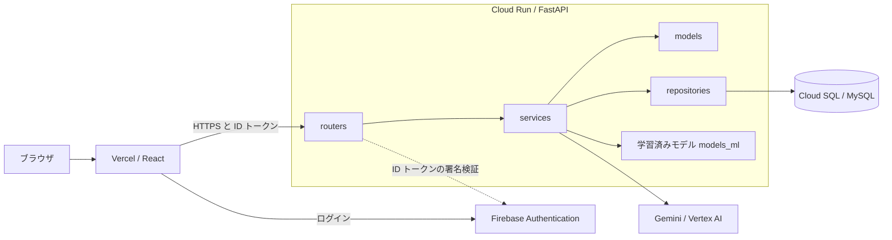
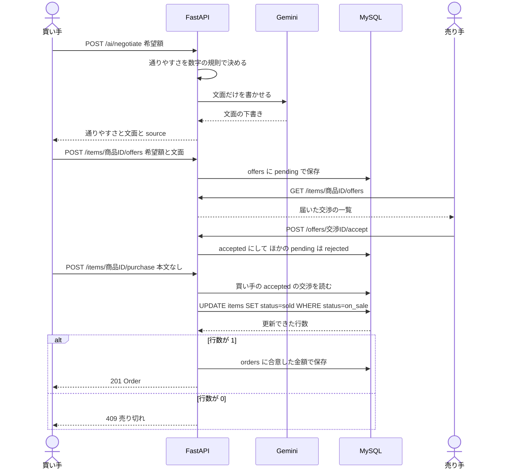

# Nego(仮)— backend

[](https://github.com/panda2345pand-design/hackathon-backend/actions/workflows/ci.yml)

UTTC 10期 ハッカソン(AIコース)の課題「次世代フリマアプリ」のバックエンド。作者:水谷 風賀。

コンセプトは **「AI が売り手と買い手のあいだに立つフリマ」**。

- 出品するとき:Gemini が説明文の下書きを書き、機械学習モデルが適正価格の目安を出し、出品できない物は理由をつけて止める
- 買うとき:適正価格の目安とその理由を見て、AI に手伝ってもらいながら価格交渉ができる。合意した金額で購入できる
- **AI 同士の価格交渉**:売り手は最低価格を、買い手は上限を、自分の AI にだけ伝える。2 つの AI が最大 4 往復して合意額を出す(金額は規則が決め、Gemini はせりふを書く)
- 探すとき:教師なし学習で分けた「AI ジャンル」と「似ている商品」が出る

| | URL |
|---|---|
| アプリ(フロントエンド) | https://hackathon-frontend-smoky-xi.vercel.app |
| API(このリポジトリ) | https://hackathon-backend-651327414604.asia-northeast1.run.app |
| API の一覧(OpenAPI / Swagger UI) | https://hackathon-backend-651327414604.asia-northeast1.run.app/docs |
| フロントエンドのリポジトリ | [hackathon-frontend](https://github.com/panda2345pand-design/hackathon-frontend)(React / Vercel) |

FastAPI(Python)+ SQLAlchemy + Alembic + scikit-learn + Gemini。本番は Cloud Run + Cloud SQL(MySQL)。

## 目次

- [60 秒で試す](#60-秒で試す)
- [必須技術との対応](#必須技術との対応)
- [全体の構成](#全体の構成)
- [構成(レイヤードアーキテクチャ・4層)](#構成レイヤードアーキテクチャ4層)
- [機能と API](#機能と-api)
- [設計で決めたこと](#設計で決めたこと)
- [機械学習](#機械学習)
- [テストと CI](#テストと-ci)
- [正直な限界](#正直な限界)
- [AI の使い方](#ai-の使い方)
- [動かし方(ローカル)](#動かし方ローカル)
- [DB のマイグレーション(Alembic)](#db-のマイグレーションalembic)
- [デプロイ(Cloud Run)](#デプロイcloud-run)

## 60 秒で試す

登録は要らない。ログイン画面に、お試し用の共用アカウントで入るボタンが 2 つある。

1. https://hackathon-frontend-smoky-xi.vercel.app を開き、「ログイン」を押す
2. **「買い手として試す」** を押す
3. 「ノースフェイス マウンテンパーカー 黒 Lサイズ」を開く(売り切れていたら、ほかのどの商品でもよい)
4. 「AI の適正価格の目安」に、金額・幅・「この目安になった理由」が出る。「このAIの精度」を開くと誤差(MAE)と決定係数(R²)が出る
5. 「価格交渉する」を押して希望額を入れる → 通りやすさの目安と、出品者に送る文面の下書きが出る
6. ログアウトして、ログイン画面で **「売り手として試す」** を押す
7. 「出品する」で、「AI で説明文を書く」と「AI に価格を聞く」を試す
8. 商品名に「スーパーコピー」などを入れて出品すると、理由つきで止められる(入力した内容は消えない)
9. 「AI のしくみ」のページに、どの機能でどの AI が何をしているかをまとめてある

お試し用アカウントはほかの人も同じものを使うので、商品が売り切れていたり、見覚えのない交渉が届いていたりすることがある。

## 必須技術との対応

| 課題の要件 | このアプリでの実装 | 場所 |
|---|---|---|
| バックエンドは Python | FastAPI | `app/` |
| フロントエンドは React | Vite + React 19 + TypeScript | [hackathon-frontend](https://github.com/panda2345pand-design/hackathon-frontend) |
| Gemini API | 説明文の生成/出品禁止物の審査(キーワードの規則の次に Gemini)/価格交渉の文面/AI 同士の価格交渉のせりふ/写真から出品の下書き/英語でない商品名を機械学習モデル用に英語へ直す | `app/services/ai.py` |
| ユーザー認証 | Firebase Authentication。ID トークンをバックエンドで署名検証する | `app/auth.py` |
| 出品 | `POST /items`(禁止物チェック → 価格予測・クラスタ付与 → 保存) | `app/services/items.py` |
| 購入 | `POST /items/{id}/purchase`(決済はしない。同時に買っても成功するのは 1 人) | `app/services/items.py` |
| 教師あり学習 | 価格予測(Ridge 回帰)。目安の金額と幅、理由を出す | `ml/train_price.py`, `app/ml/predictor.py` |
| 教師なし学習 | クラスタリング(KMeans)。「似ている商品」とホームの「AI ジャンル」に使う | `ml/train_cluster.py`, `app/ml/predictor.py` |
| デプロイ | Cloud Run(API)/ Vercel(画面)/ Cloud SQL(MySQL) | `Dockerfile` |

## 全体の構成



価格交渉から購入までの流れ。金額を決めるのは最後までサーバーで、画面は金額を送らない。



## 構成(レイヤードアーキテクチャ・4層)

```
app/
  main.py          エントリポイント(ルーターを束ねるだけ)
  config.py        設定(環境変数)
  auth.py          認証(Authorization ヘッダーから「誰か」を決める)
  db.py            DB 接続(SQLAlchemy)
  routers/         ① コントローラー層:HTTP ↔ JSON。処理は書かない
  services/        ② ユースケース層:出品する・購入する・説明文を生成する…
  models/          ③ モデル層:User / Item / Order / Offer / Like / Negotiation / Image / Notification。ID と作成日時はここの生成関数で作る
  repositories/    ④ リポジトリ(DAO)層:モデル ↔ SQL
  schemas/         リクエスト/レスポンスの形(pydantic)
  ml/              学習済みモデルの読み込みと推論
  db_migrate.py    起動時のマイグレーション(Alembic を呼ぶ)
migrations/        テーブルの変更の履歴(Alembic)。versions/ の1ファイル=1回の変更
ml/                学習スクリプトと学習レポート
models_ml/         学習済みモデルと、学習時に書き出した指標
scripts/           デモデータを入れる(seed.py)、既存の商品に最低価格を埋める(backfill_min_price.py)
seed/              デモ用の初期商品 300 件と、その出典
tests/             pytest
```

### ポリシー(先に決めておくこと)
- **ID は UUID。モデルの生成関数(`new_user()` / `new_item()` / `new_order()` など)が作る。** フロントエンドから ID・作成日時・確定金額は受け取らない。
- 層をまたいで飛ばさない(routers → services → repositories → DB)。
- 外部 API(Gemini)・学習済みモデルの呼び出しは services に置く。

## 機能と API
仕様は [docs/api.md](docs/api.md)。起動後は `/docs`(Swagger UI)でも見られる。

| 機能 | 主なエンドポイント | 実装の場所 |
|---|---|---|
| 登録・認証 | `POST /auth/register`, `GET /me` | `app/auth.py`, `services/users.py` |
| 出品(禁止物チェック → 価格予測・クラスタ付与 → 保存) | `POST /items` | `services/items.py` |
| 一覧・検索・詳細 | `GET /items`, `GET /items/{id}` | `repositories/items.py` |
| 購入(同時購入は1人だけ成功) | `POST /items/{id}/purchase` | `services/items.py` |
| 価格交渉 | `POST /items/{id}/offers`, `POST /offers/{id}/accept` | `services/offers.py` |
| AI 同士の価格交渉(金額は規則、せりふは Gemini) | `PATCH /items/{id}/min-price`, `POST /items/{id}/auto-negotiate`, `GET /items/{id}/negotiations` | `services/negotiation_rule.py`, `services/auto_negotiation.py` |
| 写真(アップロード・配信・写真から出品の下書き) | `POST /images`, `GET /images/{id}`, `POST /ai/describe-image` | `services/images.py`, `services/ai.py` |
| お知らせ(アプリ内) | `GET /me/notifications`, `POST /me/notifications/read-all` | `services/notifications.py` |
| 教師あり学習:価格予測 | `GET /items/{id}/price-estimate`, `POST /ai/price` | `app/ml/predictor.py`, `ml/train_price.py` |
| 教師なし学習:クラスタリング | `GET /clusters`, `GET /items/{id}/similar` | `app/ml/predictor.py`, `ml/train_cluster.py` |
| Gemini:説明文・禁止物の審査・交渉の文面 | `POST /ai/describe`, `/ai/check`, `/ai/negotiate` | `services/ai.py` |
| どの AI が何で動いているか | `GET /ai/info` | `routers/ai.py` |
| いいねされやすさ(検証して載せなかった。いつも `available: false`) | `POST /ai/attention` | `routers/ai.py`, [ml/LIKE_REPORT.md](ml/LIKE_REPORT.md) |

### 認証の2つのモード(`AUTH_MODE`)
- `dev`(既定):`Authorization: Bearer dev:<uid>` をそのまま信じる。ローカルとテスト用。
- `firebase`(本番):Firebase の ID トークンを Google の公開鍵で署名検証する。**本番では必ずこちら。**

## 設計で決めたこと

### 1. ID・日時・金額はサーバーだけが決める
- ID(UUID)と `created_at` を作るのは、`app/models/entities.py` の生成関数(`new_user()` / `new_item()` / `new_order()` / `new_offer()` / `new_like()` / `new_negotiation()` / `new_image()` / `new_notification()`)だけ。
- 出品の入力の形(`app/schemas/__init__.py` の `ItemIn`)に ID・状態・日時の項目は無い。購入の API は本文を受け取らない。
- 購入金額は `app/services/items.py` の `purchase()` が決める。買い手に承諾済みの交渉があればその金額、なければ出品価格。
- テスト:`tests/test_api.py` の `test_client_cannot_set_id_or_status`、`test_offer_accept_then_purchase_at_offer_price`、`test_other_buyer_pays_list_price`。

### 2. 同じ商品が 2 回売れないようにする(二重の守り)
- 1 つ目:「販売中なら売り切れにする」を SQL 1 文でやる(`app/repositories/items.py` の `mark_sold_if_on_sale()`)。`UPDATE items SET status='sold' WHERE id=… AND status='on_sale'` を実行し、更新できた行数が 1 のときだけ先へ進む。
- 2 つ目:`orders.item_id` に UNIQUE 制約(`app/models/entities.py` の `Order`)。1 つ目をすり抜けても、DB が 2 件目の注文を拒否する。
- テスト:`tests/test_api.py` の `test_concurrent_purchase_only_one_wins`(2 人が同時に買い、結果が 201 と 409 になること)。
- 本番の MySQL でも、2 人の買い手から同時に購入を送り、片方が 201、もう片方が 409 になることを確かめた(2026-11-15)。

### 3. 交渉の通りやすさは、説明できる数字の規則で決める
- 過去の価格交渉のデータが無いので、学習はできない。そこで通りやすさ(high / mid / low)は規則で決め、Gemini には文面だけを書かせている(`app/services/ai.py` の `acceptance_level()` と `negotiate()`)。
- 規則:希望額 ÷ 出品価格が 90% 以上なら high、75% 以上なら mid、それ未満は low。そのうえで価格予測の目安と比べて 1 段だけ動かす(出品価格が目安より高めで希望額が目安に近ければ上げる。希望額が目安の 7 割を下回れば low)。
- 根拠の文(「希望額は出品価格の 84% です」など)も同じ関数が作り、応答に入れる。
- テスト:`tests/test_ai_rules.py`。

### 4. AI の出力には出どころを付け、Gemini が止まってもアプリは止めない
- Gemini を使う応答(`/ai/describe`・`/ai/check`・`/ai/negotiate`)には `source` を付ける。`gemini` = Gemini が作った、`rule` = キーワードの規則で止めた、`fallback` = Gemini が使えず定型文を返した。
- Gemini のキーが無い・失敗した・時間切れのときは、定型の文を返して `source: "fallback"` にする。画面はこれを「AI 未接続(定型文)」と表示する。
- 価格予測のモデルが読めないときは `available: false` を返し、数値は出さない(`app/services/ml_gateway.py`)。
- 出品禁止物は、まずキーワードの規則(`PROHIBITED_RULES`)、次に Gemini の順に見る。規則で止めたときは、どの語に当たったかを理由に入れる。
- テスト:`tests/test_api.py` の `test_ai_describe_fallback`、`tests/test_warmup.py` の `test_startup_works_without_gemini`、`tests/test_ml.py` の `test_unavailable_forms`。

### 5. Gemini の遅さを実測して直した
経緯は `app/services/ai.py` のコメントとコミット履歴に残してある。

- はじめは 1 回 8 秒ほどかかった。`thinking_budget=0`(考える時間を切る設定)を入れた。
- それでも約半分の回でモデルが考えてしまい、5〜13 秒かかった(ログの thoughts が 400〜1800 トークンの回が遅い)。
- システム指示に「考える過程は不要です。すぐに答えだけを出力してください。」の 1 文を足すと止まった。直した直後の実測は 10 回中 10 回で 1.3〜3.4 秒、本番での 20 回の実測は 1.4〜4.8 秒。
- 保険として、3 秒たっても返らなければ同じ問い合わせをもう 1 本出し、先に返った方を使う(`_ask_json()`。遅い回は 2 回分の料金がかかる)。テストは `tests/test_hedge.py`。
- Cloud Run の新しいインスタンスでは 1 回目だけ 10〜12 秒かかったので、起動時に別スレッドで 1 回だけ呼んでおく(`warm_up()`)。テストは `tests/test_warmup.py`。
- 接続を IPv4 に固定する案も試したが、効果が無かったので取り消した。

### 6. テーブルの変更は Alembic で履歴にする
- 起動時に `app/db_migrate.py` の `run_migrations()` が実行する。Alembic を入れる前から動いていた本番 DB には、テーブルに触らず「baseline まで適用済み」の印だけを付ける。
- マイグレーションを全部実行して作るテーブルが、モデルの定義と同じであることをテストで確かめている(`tests/test_migrations.py` の `test_migrations_match_models`)。
- baseline(0001)の時点の本番の MySQL のスキーマとは突き合わせ、33 列・16 インデックス・7 外部キーが一致することを確かめた(2026-11-15)。
- 0002(AI 同士の価格交渉・写真・お知らせ)は、足すだけの変更にしてある。MySQL は DDL を取り消せないので、1 つずつ「無ければ作る」にして、途中で失敗しても再実行できるようにした(`test_0002_can_be_rerun_after_a_partial_failure`)。**0002 は手元の SQLite でだけ実行した。MySQL については、流れる SQL の文面を確かめただけ**(`test_0002_sql_for_mysql`)。
- 手順と決まりは下の「[DB のマイグレーション(Alembic)](#db-のマイグレーションalembic)」。

### 7. AI 同士の価格交渉:結果は規則が決め、Gemini は言葉だけを書く
- 合意するか・いくらで合意するかは、`app/services/negotiation_rule.py` の `negotiate()` が決める。DB も Gemini も使わない計算で、同じ入力なら必ず同じ結果になる。
- なぜ Gemini に決めさせないか:
  - お金に関わる結果が、呼ぶたびに変わっては困る。規則なら「なぜこの金額か」を式で説明でき、テストで全部の場合を確かめられる(`tests/test_negotiation_rule.py`)。
  - 「合意額は最低価格以上・上限以下・出品価格以下」を、規則なら必ず守れる。文章を作るモデルには保証させられない。
  - Gemini が止まっても交渉は成立する(せりふが定型文になるだけ。`source: "fallback"`)。
- 規則:買い手は出品価格の 70% から上限へ、売り手は出品価格から最低価格へ、4 往復で同じ幅ずつ歩み寄る。買い手の提示が売り手の提示以上になった往復で、2 つの中間(100 円単位)で合意。上限が最低価格より低いときだけ不成立。
- Gemini の仕事は、決まった金額を各往復のせりふにすること。呼ぶのは会話全体で 1 回。返ってきたせりふにその往復の金額が入っていなければ、全体を定型文に切り替える(`app/services/ai.py` の `negotiation_messages()`)。
- 合意したら、記録(negotiations)・承諾済みの交渉(offers)・出品者へのお知らせを 1 つのトランザクションで保存する。だから既存の購入の処理は変えずに、合意額で買える(`tests/test_auto_negotiation.py` の `test_agreed_then_purchase_at_agreed_price`)。
- 最低価格(`min_price`)は出品者本人にだけ、上限(`max_price`)は買い手本人にだけ返す(`test_min_price_is_visible_only_to_the_seller`、`test_negotiation_list_and_privacy`)。ただし往復の金額から逆算はできる(下の「正直な限界」)。

### 8. 写真は、今は DB に入れる
- `POST /images` で受け取った写真は、バイト列のまま `images` テーブルに入れ、`GET /images/{id}` で返す(MySQL では MEDIUMBLOB)。
- なぜ:Cloud Run のコンテナのディスクは再起動で消えるので、ファイルとしては置けない。Cloud Storage を使うのが本来の形だが、バケット・権限・署名つき URL の設定が増える。ハッカソンの期間では、すでにある DB だけで完結させ、バックアップも DB 1 つで済むほうを選んだ。
- この選び方の限界:
  - 写真を表示するたびに、アプリと DB を通る(CDN から直接は配れない)。同じ写真は `Cache-Control: immutable` でブラウザに 1 年使い回させて、回数を減らしている。
  - DB が写真の分だけ大きくなる(1 枚最大 2MB)。枚数が増えると、バックアップと復元が遅くなり、DB の料金も増える。
  - 1 枚を丸ごとメモリに載せて返すので、大きい写真は扱えない。だから 2MB までにしている。
  - 利用者が増えたら、保存先を Cloud Storage に移す。画面は `image_url` を見ているだけなので、URL を変えれば移せる。
- 写真の種類は、ファイルの先頭のバイト列で決める(`app/services/images.py` の `detect_content_type()`)。リクエストの Content-Type は送る側が自由に書けるので信用しない。
- `image_ai_generated`(AI が作ったイメージ画像か)は、出品のときに 1 回だけ調べて `items` の列に入れる。一覧のたびに `images` を引かないため。

## 機械学習
- データ:MerRec(Mercari US, CC BY-NC 4.0)2023年5月分の4ファイル。出典は [seed/README.md](seed/README.md)。
- 価格予測:Ridge 回帰(alpha 3.0。タイトルの TF-IDF + カテゴリ・ブランド・状態の one-hot)。テスト 141,614 商品で MAE 34.13 USD(カテゴリ別中央値のベースラインは 45.30 USD)。R² は対数価格で 0.510、実額(USD)で 0.279。
- 目安の幅:validation での残差の 25%〜75% 点を予測に足したもの。test で実際の価格がこの幅に入った割合は 50.3%。**「約半分は外れる幅」であって、「必ずこの中に入る」という意味ではない。**
- クラスタリング:TF-IDF → SVD 50次元 → KMeans(k=38、シルエット係数 0.356)。
- クラスタの日本語名:`models_ml/cluster_labels_ja.json`(手作業の対応表)。中身が寄せ集めの3つ(23・28・31)は `hidden` にして、ホームの一覧(`GET /clusters`)に出さない。学習し直したら付け直す。
- 「似ている商品」は、同じクラスタの中で同じカテゴリの商品を先に並べる(`app/repositories/items.py` の `similar()`。黒いパーカーの「似ている商品」に黒いインクが先頭に出たのを本番で見て直した)。
- 日本語の商品名は、Gemini で英語に直してからモデルに渡す(`app/services/ai.py` の `title_for_ml()`)。英語に直したことは、目安の理由の欄にも出す。
- **学習レポート:[ml/REPORT.md](ml/REPORT.md)**(データ・モデル・指標・k の決め方の弱さ・限界。記録に無い数字は「不明」と書いてある)。
- 数字の出どころは `models_ml/price_metrics.json`・`models_ml/cluster_info.json`。学習し直しは `python -m ml.train_price` / `python -m ml.train_cluster`(要 `pip install -r ml/requirements-train.txt` と `data/` のデータ)。

## テストと CI
- `pytest` で 110 件(API の結合テスト、同時購入、交渉から購入まで、AI 同士の価格交渉の規則と合意額での購入、写真、お知らせ、禁止物の規則、機械学習の推論、クラスタの日本語名、マイグレーション、Gemini の 2 本目の問い合わせ、ウォームアップ)。
- テストは SQLite と `AUTH_MODE=dev` で、Gemini のキーが無い状態で動く(`tests/conftest.py`)。
- GitHub Actions(`.github/workflows/ci.yml`)が、main への push とプルリクエストごとに `pytest` を実行する。結果はこのページの先頭のバッジ。

## 正直な限界

- **価格は日本の相場と合わない。** 学習データは米国メルカリ(英語・USD)で、円の値は 1 USD = 150 円の固定で換算しただけ(`app/ml/predictor.py` の `USD_JPY`)。「しくみが動くこと」を見せるためのもので、日本で使える価格ではない。
- **デモ商品の写真は実物ではない。** 元のデータセットに画像が無い。見本用に AI が作ったイメージ画像を付けた商品は `image_ai_generated: true` で返し、画面で「AI 生成のイメージ」と明記する。
- **AI 同士の価格交渉では、往復の金額から相手の限度額が分かる。** `min_price` / `max_price` という項目は本人にしか返さないが、4 往復目の提示は限度額そのもので、それより前でも歩み寄りの幅が一定なので逆算できる。1 人 5 回までの制限では防げない。防ぐには規則のほうを変える必要がある(例:不成立のときは最後の提示を見せない、歩み寄りの幅を一定にしない)。
- **AI 同士の価格交渉の数字(70% から始める・4 往復・中間で合意)は仮の値。** 実際の交渉データで確かめたものではない。
- **写真は DB に入れている。** 枚数が増えると DB が重くなる(「設計で決めたこと」の 8)。
- **2 本目の教師あり学習(いいねされやすさ)は載せていない。** test AUC 0.612 で、事前に決めた基準 0.65 に届かなかった([ml/LIKE_REPORT.md](ml/LIKE_REPORT.md))。
- **k=38 の根拠は弱い。** シルエット係数は k を増やすほど上がり続け、参考に測った k=50〜100 のほうが高かった。38 は「画面に出すラベルは 40 個まで」という都合の中で選んだ数。詳しくは [ml/REPORT.md](ml/REPORT.md)。
- **高い商品で誤差が大きい。** MAE(34.13 USD)は中央絶対誤差(10.50 USD)の約 3.3 倍で、少数の大外れが平均を押し上げている。価格帯別の誤差は測っていない。
- **英語に直した商品名での精度は測っていない。** 日本語の商品名は Gemini で英訳してからモデルに渡しているが、その経路での誤差は不明。
- **交渉の規則のしきい値(90% / 75%)は仮の値。** 実際の交渉データで確かめたものではない。
- **決済は無い。** 「購入」は注文の記録を作り、商品を売り切れにするだけ。
- **禁止物のキーワードは代表例だけ。** 全部ではない。規則に当たらないものは Gemini の判断に頼り、Gemini が使えないときは規則だけになる。
- **データのライセンスは CC BY-NC 4.0(非営利のみ)。** このモデルは商用のサービスには使えない。

## AI の使い方

- このリポジトリのコードの多くは、AI のコーディングアシスタント(Claude Code)を使って書いた。作るものと方針は作者が決めて指示した。
- AI と書いたコミットには、コミットメッセージに `Co-Authored-By` を残している。
- アプリの中で使っている AI(Gemini と 2 つの機械学習モデル)は、上の「[必須技術との対応](#必須技術との対応)」と「[機械学習](#機械学習)」のとおり。

## 動かし方(ローカル)

```bash
python -m venv .venv && source .venv/bin/activate
pip install -r requirements.txt
cp .env.example .env
uvicorn app.main:app --reload --port 8000
# http://localhost:8000/docs
pytest
```

Gemini のキーが無くても動く(AI の文章は定型文になり、`source` が `fallback` になる)。

### デモデータ
```bash
python -m scripts.seed          # 商品が無いときだけ 300 件入れる
python -m scripts.seed --reset  # デモ用ユーザーの商品を入れ直す
python -m scripts.backfill_min_price --dry-run  # すでにあるデモ商品のうち、最低価格が未設定の件数を見る(外すと実際に埋める)
```

### 環境変数
値は `.env`(ローカル)か Cloud Run のサービス設定で渡す。定義は `app/config.py`、ローカル用の例は `.env.example`。

| 名前 | 内容 |
|---|---|
| `DATABASE_URL` | DB の接続先。既定はローカルの SQLite |
| `AUTH_MODE` | `dev`(既定)か `firebase` |
| `FIREBASE_PROJECT_ID` | ID トークンの検証に使う Firebase のプロジェクト ID |
| `GEMINI_API_KEY` | Gemini を API キーで使うとき |
| `GEMINI_USE_VERTEX` / `GEMINI_PROJECT` / `GEMINI_LOCATION` | Gemini を Vertex AI で使うとき |
| `GEMINI_MODEL` | 使う Gemini のモデル名 |
| `CORS_ORIGINS` / `CORS_ORIGIN_REGEX` | 画面のオリジンの許可 |
| `SEED_ON_EMPTY` | `true` のとき、起動時に商品が 1 件も無ければデモデータを入れる |
| `PUBLIC_BASE_URL` | 写真の URL の先頭に使う、このバックエンドの公開 URL(本番は `https://…`)。空ならリクエストが届いた URL を使う |

## DB のマイグレーション(Alembic)

テーブルの形(列・インデックス)の変更は、Alembic で履歴として管理する。DB 側の `alembic_version` テーブルが「どこまで適用したか」を覚えている。

**起動時に自動で実行する**(`app/db_migrate.py` の `run_migrations()`):
- 空の DB、または印が付いている DB → `upgrade head`(まだの分だけ実行。最新なら何もしない)。
- テーブルはあるのに `alembic_version` が無い DB(Alembic を入れる前から動いていた本番)→ テーブルには触らず、「baseline(0001)まで適用済み」の印だけ付ける(stamp)。
- MySQL では名前付きロック(`GET_LOCK`)を取り、Cloud Run のインスタンスが同時に起動しても1つずつ実行する。
- DB の URL は `alembic.ini` に書かない(URL の中の `%` が ini の記法とぶつかるため)。アプリの接続/環境変数 `DATABASE_URL` をそのまま使う。

### テーブルを変えるとき(新しいマイグレーションの足し方)

```bash
# 1. app/models/entities.py を変える(例:Item に列を足す)
# 2. モデルと手元の DB の差分から、マイグレーションのひな形を作る(手元の DB が最新になっていること。アプリを1回起動すればなる)
alembic revision --autogenerate -m "items に shipping_fee を追加"
# 3. migrations/versions/ にできたファイルを必ず読んで直す(自動生成は列名の変更を「削除+追加」と誤解することがある)
# 4. 手元で適用して、テストを通す
alembic upgrade head
pytest
# 5. 本番に流れる SQL を先に見たいとき(DB にはつながない)
DATABASE_URL='mysql+pymysql://u:p@localhost/nego' alembic upgrade head --sql
```

決まり:
- **適用済みのファイル(`0001_baseline` など)は書き換えない。** 変更は必ず新しいファイルで足す。
- 既にデータがあるテーブルに NOT NULL の列を足すときは、`server_default` を付けるか、「NULL 可で追加 → 値を埋める → NOT NULL にする」の順にする。
- MySQL はテーブルの変更(DDL)を取り消せない。途中で失敗すると半端な状態が残るので、1つのマイグレーションは小さくする。
- デプロイすると起動時に本番へ適用される。新しいコードと古いコードが同時に動く時間があるので、列の削除・改名は「先にコードを対応させてデプロイ → 次のデプロイで削除」の2段階にする。
- モデルを変えてマイグレーションを足し忘れると、`tests/test_migrations.py` の `test_models_and_migrations_are_in_sync` が落ちる。
- 1つ戻す:`alembic downgrade -1`。今の版:`alembic current`。履歴:`alembic history`。

## デプロイ(Cloud Run)

```bash
gcloud run deploy hackathon-backend --source . --region asia-northeast1 --allow-unauthenticated
```
環境変数(DATABASE_URL, GEMINI_API_KEY など)は Cloud Run のサービス設定で渡す。`.env` はコミットしない。
